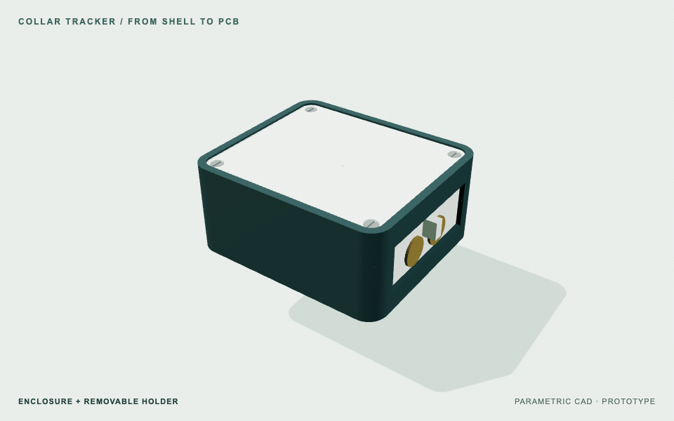
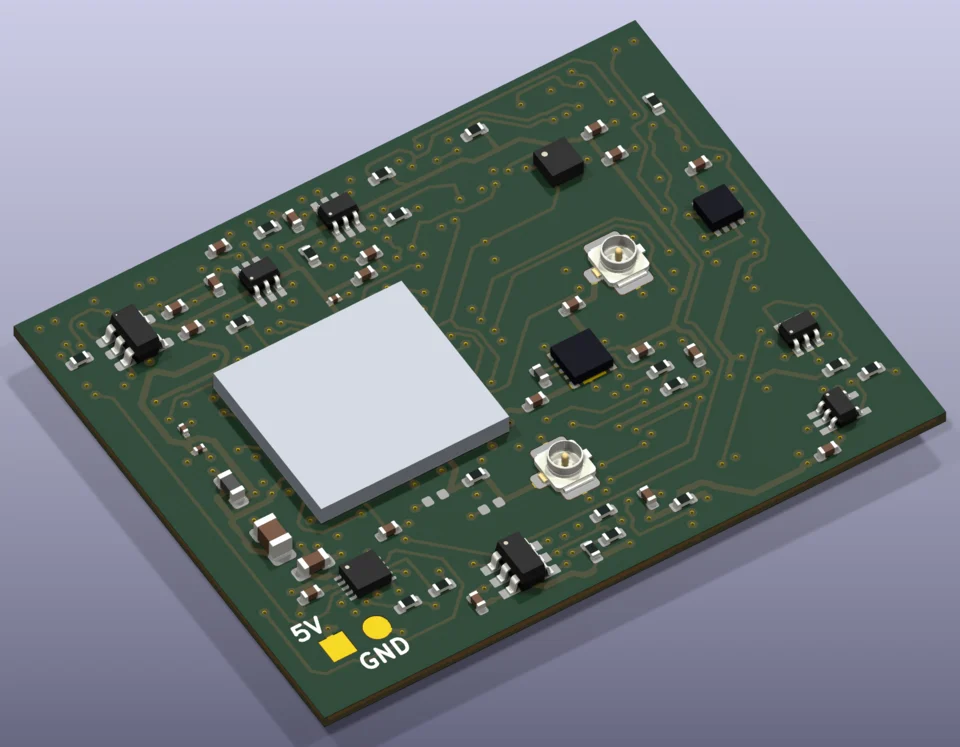
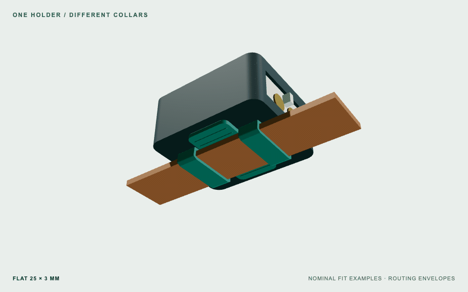
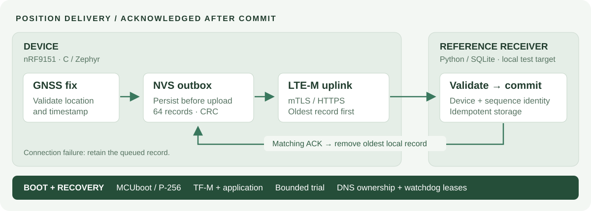

# Collar Tracker

**A GNSS + cellular dog tracker, engineered across hardware, firmware and enclosure.**

A custom six-layer PCB, a persistent position-delivery pipeline and an adjustable collar mount.
Designed for factory assembly, with versioned sources and reproducible verification.

**Stage:** engineering prototype. PCB fabrication checks pass; assembly approval and physical validation remain open.



[Explore the CAD package](release/collar-tracker-3d-universal-mount-r01.zip) · [Current status](docs/STATUS.md) · [Verification](#verification) · [Start here](#inspect-and-reproduce)

## At a glance

| Hardware | Firmware & service | Mechanical design |
| --- | --- | --- |
| **40 × 32 mm**, six copper layers | **C / Zephyr / nRF Connect SDK** | **57.4 × 49.4 × 21 mm** rigid enclosure |
| nRF9151 · GNSS · LTE-M · nano-SIM | Persistent outbox · mTLS · watchdog recovery | Retained PCB and battery · gasketed lid |
| Independent hot/cold charging interlock | MCUboot signed boot · Python/SQLite receiver | Two adjustable straps · flat and round collar pads |

## Hardware and fit

<table>
<tr>
<td width="50%"></td>
<td width="50%"></td>
</tr>
<tr>
<td><b>Current PCB.</b> 81 fitted components, 44 exact part numbers, two dedicated ground planes.</td>
<td><b>Adjustable attachment.</b> Two replaceable wrap straps and interchangeable grip pads; six nominal collar examples checked.</td>
</tr>
</table>

*CAD illustrations: four PCB package bodies are dimensional substitutes; installed bands show routing envelopes. Physical grip, comfort and ingress protection are unqualified.*

[Native KiCad source](experiments/pcba-r05m-rohm-q1/hardware/) · [BOM and placement review](assembly/pcba-r03/README.md) · [Dimensions and mount assembly](mechanical/universal-mount-r01/README.md)

## System architecture



The device persists each valid fix before attempting a network connection.
The receiver commits the record before acknowledging its sequence; only a matching acknowledgment removes the oldest queued record.
Retries are idempotent for the same device, sequence and payload.
The receiver is a local integration target; no public service or production credentials are configured.

[Tracker firmware](firmware/tracker-r03/README.md) · [Recovery behavior](firmware/tracker-r02/README.md) · [Receiver protocol](firmware/receiver/README.md)

## Engineering decisions

- **Preserve failure ownership.** A DNS timeout bounds the caller's wait; the resolver still owns its eventual result. Late results are freed, overlapping calls are prevented, and expired watchdog leases stay expired.
- **Confirm updates with useful work.** A trial image must persist a fresh fix, receive an upload acknowledgment and remain healthy within a bounded window. Signed boot and trial policy are implemented; update delivery and hardware rollback testing remain open.
- **Keep charging protection independent.** Hardware temperature comparators control charge enable independently of application firmware. Powered fault testing is still required.
- **Make releases inspectable.** Native sources, manufacturing outputs, supplier reports and checks are tied together by hashes. Rejected experiments remain available alongside the chosen design.

## Verification

| Layer | Recorded result | Evidence |
| --- | --- | --- |
| Native CAD | Zero DRC/ERC findings, open connections and schematic mismatches under the documented check profile | [Reports and exclusions](assembly/pcba-r03/native-checks.json) |
| PCB fabrication | Two JLC PCB analyses: **0 Danger / 0 Warning** on identical Gerber bytes and unchanged rules | [Report 1](experiments/power-r05l-charge-interlock/evidence/jlc-check1/report.pdf) · [Report 2](experiments/power-r05l-charge-interlock/evidence/jlc-check2/report.pdf) |
| Firmware | Custom-target builds, image/signature inspection and host fault-injection tests | [Build and test evidence](firmware/evidence/tracker-r03/build-evidence.json) |
| Mechanics | **33** closed meshes; **25** nominal interference queries with no positive-volume intersection | [Meshes](mechanical/universal-mount-r01/mesh-checks.json) · [Fit checks](mechanical/universal-mount-r01/fit-checks.json) |

The current **r05m** part-selection revision preserves the tested **r05l** copper and Gerber bytes.
These are saved results; the integrity checker does not rerun KiCad, JLC or physical tests.

**Next gates:** resolve the [SMT/model and process findings](assembly/pcba-r03/smt-disposition.md), then validate assembled hardware, provisioning, radio behavior, battery runtime and the complete enclosure.
Türkiye operator compatibility, physical mount comfort and IP68 remain unqualified; heart-rate sensing is not implemented.

## Inspect and reproduce

```sh
git clone --depth 1 https://github.com/gokselozgur5/pcb-design-collar-tracker.git
cd pcb-design-collar-tracker
python3 scripts/verify_handoff.py
```

The command checks saved evidence and artifact integrity without changing CAD or contacting a manufacturer.
For the interactive model, extract the [CAD package](release/collar-tracker-3d-universal-mount-r01.zip) and open `mechanical/universal-mount-r01/viewer.html` locally.

| Start with | What it contains |
| --- | --- |
| [STATUS](docs/STATUS.md) / [RESUME](docs/RESUME.md) | Exact active revisions, open work and toolchain commands |
| [PCB Design handbook](docs/PCB_DESIGN.md) | Requirements, source review, routing, verification and release workflow |
| [Firmware build guide](firmware/tracker-r03/README.md) | Pinned build inputs, image inspection and test scope |
| [Manufacturing review](assembly/pcba-r03/README.md) | Selected parts, placement data and remaining assembly gates |
| [Work log](docs/WORKLOG.md) / [Media sources](docs/media/README.md) | Design history and reproducible README visuals |

The root `hardware/` directory is historical. Use the active sources linked above.
